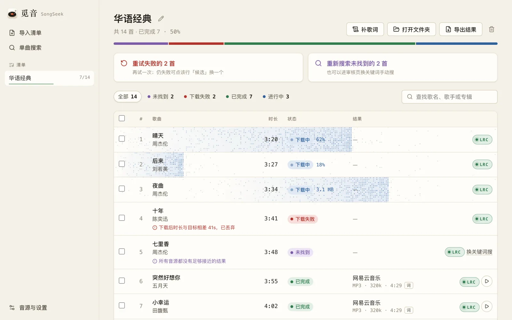
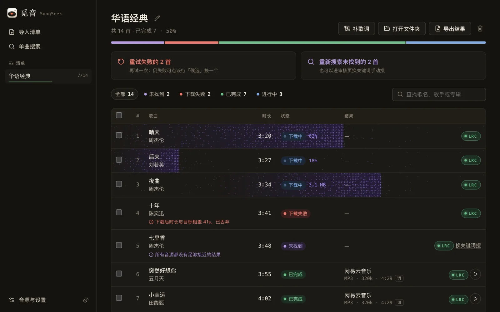

# 觅音 · SongSeek

<p align="center">
  
</p>

<p align="center">Import a playlist, search many sources, review the matches, and download a tagged local library with lyrics in one go</p>

<p align="center">
  
  
  <a href="#license"></a>
</p>

<p align="center"><a href="README.md">简体中文</a> · <strong>English</strong></p>

> The interface is in Simplified Chinese; the sources it searches are mainly Chinese music services.

## Features

- Import playlists from XLSX, CSV, Markdown tables or plain text, with column mapping and an import preview
- Parallel search across NetEase Cloud Music, QQ Music, Kugou, zpod, Bilibili and YouTube
- Scores title, artist, duration, version (live, instrumental, …), quality and popularity, then picks the best candidate automatically
- Low-confidence songs go to a review page where you can preview candidates, pick one by hand, or search again with other keywords
- Batch download with duration and full-decode checks, tags and album art written, identical files deduplicated
- A downloading song's whole row displays dot-matrix progress in orange for the light theme and purple for the dark theme, with live percent or bytes downloaded
- One-click status filters (not found, failed, … each with its own colour); the filter and search bar stays pinned while scrolling, and a bulk-action bar floats up when songs are selected
- Append songs to an existing playlist with duplicate detection; distinguish source connection failures from songs not found
- Redownload moved or deleted files from the selected candidate, and recover eligible published audio records after an interruption
- Per-song LRC lyrics switch; fetch lyrics for already-downloaded songs in one click
- Single-song search with an artist mode, a full-screen player, and CSV export of results
- Light and dark themes, or follow the system, switched from the sidebar
- Automatic proxy detection; domestic sources always connect directly
- Desktop apps for macOS and Windows with ffmpeg, ffprobe and yt-dlp bundled; closing the window quits at once. A command-line interface is included too

## Screenshots



<details>
<summary>Dark theme</summary>



</details>

## Install

Download an installer from [GitHub Releases](https://github.com/b1mango/SongSeek/releases), or build it as described under Development.

- **macOS (Apple Silicon)**: open `觅音-<version>-mac-arm64.dmg` and drag 觅音 into Applications. The app is not notarized, so on first launch right-click 觅音 in Finder and choose Open.
- **Windows**: build on Windows x64, unzip and run `SongSeek.exe`. Requires the Microsoft Edge WebView2 Runtime.

Data lives in `~/Library/Application Support/SongSeek` on macOS, `%APPDATA%\SongSeek` on Windows and `~/.local/share/songseek` on Linux; override it with `SONGSEEK_HOME`. Logs are in `logs/app.log` inside the data directory. The service only listens on the loopback address.

## Development

Requires Python 3.12, [uv](https://docs.astral.sh/uv/) and Node.js 22; running from source also needs `ffmpeg` and `ffprobe` on the system. Building for macOS needs Apple Silicon and the Xcode command line tools.

```bash
uv sync --extra desktop --group build
cd web && npm ci && npm run build && cd ..
uv run --extra desktop songseek app      # desktop window
uv run songseek serve                    # backend only, 127.0.0.1:8765
uv run pytest -q                         # tests (no network, no personal credentials)
./scripts/build_macos.sh                 # builds dist/觅音.app and the DMG
# Windows: uv run --extra desktop --group build python scripts/build_desktop.py
```

Offline demo: `SONGSEEK_MOCK=1 SONGSEEK_HOME=/tmp/songseek-mock uv run songseek serve --no-open`. Self-check a packaged build: `dist/觅音.app/Contents/MacOS/SongSeek --selftest`.

<details>
<summary>Command line</summary>

```bash
uv run songseek import songs.xlsx --name my-playlist
uv run songseek playlists
uv run songseek search 1
uv run songseek review 1
uv run songseek download 1
uv run songseek search-one "晴天 周杰伦" --duration 269 --json
uv run songseek providers --health
uv run songseek verify /path/to/song.mp3
uv run songseek export 1 -o results.csv
```

Plain text is read as `title - artist` by default. `artist - title` cannot be detected reliably; use column mapping for tables or edit rows in the import preview. Songs without an artist or duration are never chosen automatically and need review.

</details>

<details>
<summary>Matching, downloads and networking</summary>

- **Match scores**: match 90–99, review 50–89, reject 0–49. Among matches, ties are broken by lossless / bitrate, then popularity, then source order. Download fallback is restricted to the same recording as the selected version.
- **Downloads**: audio from video sources is remuxed with `-c:a copy`, then checked for duration and a full decode. If the target file has the same SHA256 it is reused; different content gets a numbered name.
- **Jobs**: search and download share one concurrency limit, with at most two concurrent requests per source. Cancelling keeps finished songs, and interrupted songs are recovered on restart. Download progress is pushed over the SSE `track_progress` event, at most 5 times per second per song.
- **Launch and quit**: the window opens first and the local service starts behind it to reduce macOS activation problems. Closing the window ends the process and its child processes. Interrupted songs can be retried on the next launch; audio published before its record was saved is recovered when the recorded destination and file hash can be verified.
- **Proxy**: three modes, Auto / Manual / Off, with Auto detecting environment and system proxies. Only YouTube and the LRCLIB fallback go through the proxy. PAC is not supported.
- **NetEase**: without a cookie only free full-length audio is tried; VIP or preview URLs are rejected explicitly. Paste the full cookie or `MUSIC_U=…`; only the login cookie and optional CSRF token are kept locally with 0600 permissions. Playback depends on NetEase account permissions.
- **Security**: intended for a single local user. Uploads are capped at 20 MB and XLSX decompression at 100 MB; CSV export neutralises formula prefixes.

</details>

## Architecture

- **Backend**: Python, FastAPI + SQLite. Handles playlist import, multi-source search and matching, download verification and background jobs, and pushes state to the frontend over an HTTP API and SSE.
- **Frontend**: TypeScript, a React + Vite single-page app.
- **Desktop**: pywebview hosts the frontend window, packaged with PyInstaller, with ffmpeg, ffprobe and yt-dlp bundled.

See [`docs/API.md`](docs/API.md) for the API contract and [`packaging/THIRD_PARTY.md`](packaging/THIRD_PARTY.md) for third-party tool licenses.

## License

<a id="license"></a>

License to be decided.
